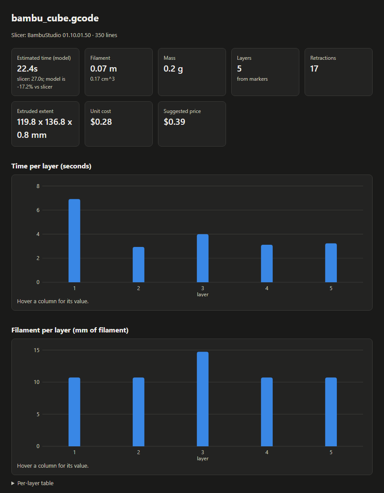

# gcode-insight

[](https://github.com/projectbin07-stack/gcode-insight/actions/workflows/ci.yml)
[](LICENSE)

Analyse FDM G-code files without a printer: filament, layers, time and cost, from the command line or from Python.

## Why

When you run a few printers for batch production, the questions before a job are always the same:
how much filament does this plate use, how long does each layer take, what does one part cost, and
what changed between two slicings of the same model. The slicer knows some of this, but only inside
its GUI, only for its own files and without a cost model. `gcode-insight` reads the G-code itself, so
it works on files from Bambu Studio, OrcaSlicer, PrusaSlicer or anything Marlin-flavoured, in scripts
and in CI, with no printer and no slicer installed.

## Features

- **Streaming parser** for `G0/G1` moves, `G2/G3` arcs (`I/J` and `R` forms), `G90/G91`, `M82/M83`,
  `G92`, `G28`, `G4`, `G20/G21`, tool changes, `M104/M109/M140/M190` temperatures and `M106/M107`
  fan commands. Files are read line by line; memory use does not grow with file size.
- **Slicer metadata** from header/footer comments: slicer name and version, estimated time, filament
  used, layer height, nozzle diameter, filament type/density/diameter. Understands the Bambu Studio,
  OrcaSlicer, PrusaSlicer/SuperSlicer and Cura comment styles and returns empty fields when they are
  absent.
- **Geometry and statistics**: layers (from `;LAYER_CHANGE` / `; CHANGE_LAYER` / `;LAYER:n` markers,
  or from Z changes when there are none), per-layer filament, extrusion path, travel path and time,
  bounding box of extruded moves, retraction count, filament length -> volume -> mass, per-tool usage.
- **Time estimate** from a documented trapezoidal motion model with per-axis speed and acceleration
  limits, compared against the slicer's own estimate when the file has one.
- **Cost model**: filament price, machine hourly rate, electricity, failure allowance, markup, fixed
  setup cost, and batch totals for N copies.
- **Output** as a terminal summary, JSON (`--json`), or a single self-contained HTML report with
  inline SVG charts (no scripts, no external assets).
- Reads plain `.gcode` and Bambu/Orca `.gcode.3mf` archives (`--plate N`).
- No runtime dependencies outside the Python standard library.

## Install

Requires Python 3.10 or newer. The package is not on PyPI; install from GitHub:

```console
pip install git+https://github.com/projectbin07-stack/gcode-insight.git
```

or from a clone:

```console
git clone https://github.com/projectbin07-stack/gcode-insight.git
cd gcode-insight
pip install .
```

## Quick start

The outputs below are real, produced from the fixtures in `tests/fixtures/`. Those fixtures are small
synthetic files written for this project; the slicer time figures inside them are placeholders, so
the "Model vs slicer" line here demonstrates the feature and says nothing about accuracy.

### Analyse a file

```console
$ gcode-insight analyze tests/fixtures/bambu_cube.gcode
G-code analysis: bambu_cube.gcode

File
  Slicer             BambuStudio 01.10.01.50
  Lines              350
  Layers             5 (detected from slicer markers)
  Layer height       0.2 mm
  Nozzle             0.4 mm
  Bounding box       119.79 x 136.79 x 0.80 mm (X 18.00..137.79, Y 1.00..137.79, Z 0.20..1.00)
  Nozzle temp (max)  245 C
  Bed temp (max)     55 C
  Fan (max)          P1: 100%, P2: 70%

Filament
  Filament length  72.62 mm (0.073 m)
  Volume           0.175 cm^3
  Mass             0.22 g
    T0 PLA         47.16 mm, 0.14 g (density 1.24 g/cm^3)
    T1 PETG        25.46 mm, 0.08 g (density 1.27 g/cm^3)
  Slicer says      72.62 mm
  Slicer mass      0.22 g

Motion
  Extrusion path  1596.4 mm
  Travel path     270.0 mm
  Retractions     17
  Tool changes    1

Time (trapezoidal model; excludes heating, homing, levelling, filament changes)
  Model estimate                22.4s
  Slicer (model printing time)  27.0s
  Model vs slicer               -5 s (-17.2%)

Layers
  layer       Z   filament mm   extrude mm   travel mm     time
      1    0.20         10.73        307.3       129.0     6.9s
      2    0.40         10.73        307.3        28.5     2.9s
      3    0.60         14.73        307.3        31.5     4.0s
      4    0.80         10.73        307.3        30.3     3.1s
      5    1.00         10.73        307.3        32.5     3.2s
```

The bounding box includes the nozzle load line at the front of the bed, because it is an extruding
move. Add `--json` for machine-readable output or `--html report.html` for the report:



### Cost a job

```console
$ gcode-insight cost tests/fixtures/bambu_cube.gcode --filament-price 22 --machine-rate 1.5 \
    --power 110 --kwh-price 0.30 --failure-rate 5 --margin 40 --copies 20 --setup-cost 2 --currency '$'
Cost estimate: bambu_cube.gcode

Basis (one copy)
  Filament mass  0.22 g
  Print time     6m 33s (slicer estimate)

Per copy
  Filament           $0.00
  Machine time       $0.16
  Electricity        $0.00
  Failure allowance  $0.01
  Setup share        $0.10
  Unit cost          $0.28
  Suggested price    $0.39

Batch of 20
  Filament mass  4.4 g
  Machine time   2h 11m 00s
  Batch cost     $5.62
  Batch price    $7.87
```

The formulas:

```text
filament    = mass_g / 1000 * filament_price
machine     = hours * machine_rate
electricity = power_watts / 1000 * hours * kwh_price
run_cost    = filament + machine + electricity
failure     = run_cost * f / (1 - f)            f = failure rate
unit_cost   = run_cost + failure + setup_cost / copies
unit_price  = unit_cost * (1 + margin)
```

`--margin` is a markup on cost, not a share of the selling price. `--failure-rate` and `--margin`
are given in percent. Batch figures assume N separate runs of the same file. By default the cost
uses the slicer's total time estimate when the file has one (`--time-source auto`), because that
includes the start-up sequence; `--time-source model` uses this tool's motion estimate instead.

### Compare two files

```console
$ gcode-insight compare tests/fixtures/orca_cube.gcode tests/fixtures/prusa_cube.gcode
                A: orca_cube.gcode  B: prusa_cube.gcode  B - A
Slicer          OrcaSlicer          PrusaSlicer
Layers          5                   6                    +1
Filament        58.5 mm             70.2 mm              +11.7 mm (+20.0%)
Mass            0.15 g              0.21 g               +0.07 g (+46.5%)
Model time      29.2s               58.1s                +29 s (+98.9%)
Extrusion path  1564.0 mm           1876.8 mm            +312.8 mm (+20.0%)
Travel path     259.1 mm            303.9 mm             +44.8 mm (+17.3%)
Retractions     15                  18                   +3
Max Z           1.00 mm             1.20 mm              +0.20 mm (+20.0%)
```

### Use it from Python

```python
from gcode_insight import AnalysisOptions, CostInputs, analyze_file, compute_cost

analysis = analyze_file("plate_1.gcode", AnalysisOptions(material="PETG"))
print(analysis.layer_count, analysis.filament_mm, analysis.mass_g, analysis.estimated_time_s)
for layer in analysis.layers:
    print(layer.index, layer.z, layer.filament_mm, layer.time_s)

cost = compute_cost(
    analysis.mass_g,
    analysis.estimated_time_s,
    CostInputs(filament_price_per_kg=22.0, machine_rate_per_hour=1.5, copies=20),
)
print(cost.unit_cost, cost.batch_price)
```

## Command reference

```console
$ gcode-insight --help
usage: gcode-insight [-h] [--version] COMMAND ...

Analyse FDM G-code files without a printer: filament, time, layers, cost.

positional arguments:
  COMMAND
    analyze   print statistics for one file
    cost      estimate cost and price
    compare   compare two files

options:
  -h, --help  show this help message and exit
  --version   show program's version number and exit
```

```console
$ gcode-insight analyze --help
usage: gcode-insight analyze [-h] [--json] [--html OUT] [--all-layers]
                             [--filament-diameter MM] [--material NAME]
                             [--density G_CM3] [--plate N] [--accel MM_S2]
                             [--travel-accel MM_S2] [--max-feedrate X Y Z E]
                             [--max-accel X Y Z E] [--jerk MM_S]
                             [--ignore-gcode-limits]
                             file

Analyse one G-code file.

positional arguments:
  file                  G-code file (.gcode or .gcode.3mf)

options:
  -h, --help            show this help message and exit
  --json                print JSON instead of text
  --html OUT            also write an HTML report
  --all-layers          list every layer in the text summary

filament:
  --filament-diameter MM
                        filament diameter (default: slicer metadata, else
                        1.75)
  --material NAME       material for the density table: PLA, PETG, ABS, ASA,
                        TPU
  --density G_CM3       filament density in g/cm^3 (overrides --material and
                        metadata)
  --plate N             plate number inside a .gcode.3mf archive (default:
                        lowest)

time model:
  --accel MM_S2         acceleration for extruding moves (default 3000)
  --travel-accel MM_S2  acceleration for travel moves (default 3000)
  --max-feedrate X Y Z E
                        maximum speed per axis in mm/s (default 500 500 20 80)
  --max-accel X Y Z E   maximum acceleration per axis in mm/s^2 (default 10000
                        10000 500 5000)
  --jerk MM_S           junction speed step (default 8)
  --ignore-gcode-limits
                        do not apply M201/M203/M204/M220 from the file; use
                        only the values above
```

`cost` takes the same filament and time-model options plus `--filament-price` (required),
`--machine-rate`, `--power`, `--kwh-price`, `--failure-rate`, `--margin`, `--setup-cost`, `--copies`,
`--time-source {auto,model,slicer}`, `--currency`, `--json` and `--html`. `compare A B` takes the
filament and time-model options and `--json`. Exit status is 0 on success and 2 on a usage or input
error.

## How it works

```text
reader.py      lines from .gcode or a plate inside .gcode.3mf
   |
parser.py      text line -> Command(code, params, flags, comment)
   |
analysis.py    Analyzer: modal state machine (position, E mode, tool, limits)
   |             |- metadata.py   comments -> SlicerMetadata
   |             |- timing.py     Planner: look-ahead trapezoid timing per move
   |             `- materials.py  length -> volume -> mass
   v
Analysis       totals + one LayerStats per layer
   |
   |- report.py       terminal text / compare table
   |- html_report.py  self-contained HTML with inline SVG
   `- cost.py         CostInputs -> CostBreakdown
cli.py         argparse front end for the above
```

Some decisions worth knowing about:

- **Filament accounting.** The extruder is tracked as one E axis with a high-water mark. Only
  material pushed beyond the furthest point reached so far counts as used, so a retract/unretract
  pair adds nothing and a final retraction does not reduce the total. Filament is attributed to the
  tool that was active when it was pushed.
- **Mass.** Density is taken, in order, from `--density`, `--material`, the slicer's
  `filament_density`, the slicer's `filament_type` looked up in the built-in table (PLA 1.24,
  PETG 1.27, ABS 1.04, ASA 1.07, TPU 1.21 g/cm^3), and finally PLA with a warning.
- **Layers.** If the file contains slicer layer markers they define the layers, and everything
  before the first marker (start G-code, purge line) is reported separately as start-up. Otherwise a
  new layer starts at each extruding move whose Z differs from the current layer's Z; non-extruding
  Z-hops do not start layers.
- **Relative/absolute E** follows Marlin 2: `G90`/`G91` also switch the extruder until `M82` or `M83`
  is seen, after which the extruder mode is fixed by those commands only.

### Time model

Each move is a block with a path length, a nominal speed and an acceleration.

- Nominal speed is the commanded feedrate (`F`, scaled by `M220`), reduced so that no axis exceeds
  its maximum speed.
- Acceleration is the print acceleration for extruding moves and the travel acceleration otherwise,
  reduced so that no axis exceeds its maximum acceleration. Extruder-only moves use the E limits.
- Speed over a block is a trapezoid: accelerate, cruise, decelerate (a triangle if the block is too
  short to reach nominal speed).
- Junctions use one "junction speed step" `jerk` (default 8 mm/s): the junction speed is the slower
  of the two nominal speeds, lowered to `jerk / |u2 - u1|` if the change in the velocity vector
  would exceed `jerk` (`u1`, `u2` are the unit directions). Collinear moves pass at full speed, a
  right angle at `jerk / 1.41`, a reversal at `jerk / 2`. Extruder-only moves start and end at rest.
- A backward and a forward pass over a sliding window of at least 64 blocks keep entry and exit
  speeds reachable.
- Arcs are single blocks with the true arc length, tangent directions at both ends and a
  centripetal limit `v <= sqrt(a * r)`.
- `M201`, `M203`, `M204` (`S`/`P`/`T`) and `M220` in the file update the limits as they are
  encountered; `--ignore-gcode-limits` disables that. `G4` dwell time is added as written.

### Accuracy limits of the time estimate

This model has **not** been validated against real print durations, and no accuracy figure is
claimed. Expect it to differ from a stopwatch and from your slicer, in particular because:

- Heating, homing, bed levelling, calibration, filament loading and AMS/MMU filament changes take
  real time and are not in the G-code as moves. They are not estimated. On short prints they
  dominate.
- Real firmware differs: Bambu printers run proprietary motion control; Klipper uses
  square-corner-velocity junctions and input shaping; Marlin may use junction deviation and S-curve
  acceleration. Corner speeds here follow the single simple rule described above.
- Pressure/linear advance, firmware-side speed or flow overrides, and limits set outside the file
  (EEPROM, printer config, Klipper `SET_VELOCITY_LIMIT`) are invisible to the model.
- The default machine profile is a generic set of numbers, not a measured profile of any printer.
  Files from Bambu Studio and PrusaSlicer usually carry `M201/M203/M204` lines, which helps; plain
  files rely entirely on the defaults or on the limits you pass.

For costing, the slicer's own estimate is used by default when present for these reasons. The model
is most useful for relative questions (which layers are slow, how two slicings compare) and for
files that carry no slicer estimate at all.

## Testing

```console
pip install -e ".[dev]"
ruff check .
ruff format --check .
mypy
pytest --cov
```

The tests check numerical results against hand-derived values (for example a 20 mm extrusion at a
known E value, and a 100 mm move whose trapezoid time is 2.05 s) and run the full pipeline on four
fixtures in the Bambu Studio, OrcaSlicer, PrusaSlicer and plain Marlin styles. The fixtures are
generated by `tests/fixtures/generate_fixtures.py`, which keeps its own independent tally of what it
wrote (`expected.json`); a test fails if the committed fixtures drift from the generator. CI runs the
same commands on Ubuntu and Windows with Python 3.10 and 3.13.

## Known limitations

- Tested only on synthetic fixtures written for this project. It has not yet been run against a
  corpus of real slicer output or checked against real print times or weighed parts.
- The time estimate has the limits described above.
- Volumetric extrusion (`M200`), per-tool offsets, mixing extruders and `M221` flow overrides are not
  handled. `G2/G3` arcs are supported in the XY plane only (`G17`); `G18/G19` and `G5` splines are
  ignored.
- The extruder is modelled as a single shared E axis. Multi-extruder machines whose tools retract
  by different amounts around a tool change can be off by that difference per change.
- `T` numbers of 100 and above are ignored as firmware-internal selectors (Bambu uses `T255`,
  `T1000`, ...).
- `M203` is read as mm/s (Marlin). RepRapFirmware's mm/min convention is not detected. Klipper
  `SET_VELOCITY_LIMIT` and other macros are passed over.
- Without layer markers, a purge line at its own Z height is counted as a layer, and spiral-vase
  prints (continuously rising Z) produce one "layer" per move.
- The bounding box covers every extruding move, including purge/prime lines. Arc extents are
  sampled every 2 degrees.
- Filled materials (CF/GF) use the density of their base polymer unless the file or `--density`
  says otherwise.
- Bambu Studio's start-up G-code contains many proprietary commands; unknown commands are skipped,
  so anything they do (and the time they take) is not reflected.

## Roadmap

- Validate against real files and measured print times from P1S / A1 / A1 Mini jobs and publish the
  comparison.
- Named machine profiles, and reading limits from Klipper `SET_VELOCITY_LIMIT`.
- Per-feature breakdown (walls, infill, support) from `;TYPE:` / `; FEATURE:` comments.
- Fixed allowances for heat-up and filament changes in the time and cost models.
- CSV export of per-layer data and a multi-file batch report.

## Contributing

See [CONTRIBUTING.md](CONTRIBUTING.md). Security reports: [SECURITY.md](SECURITY.md).

## License

MIT, see [LICENSE](LICENSE). Copyright 2026 Navaneeth KG.
